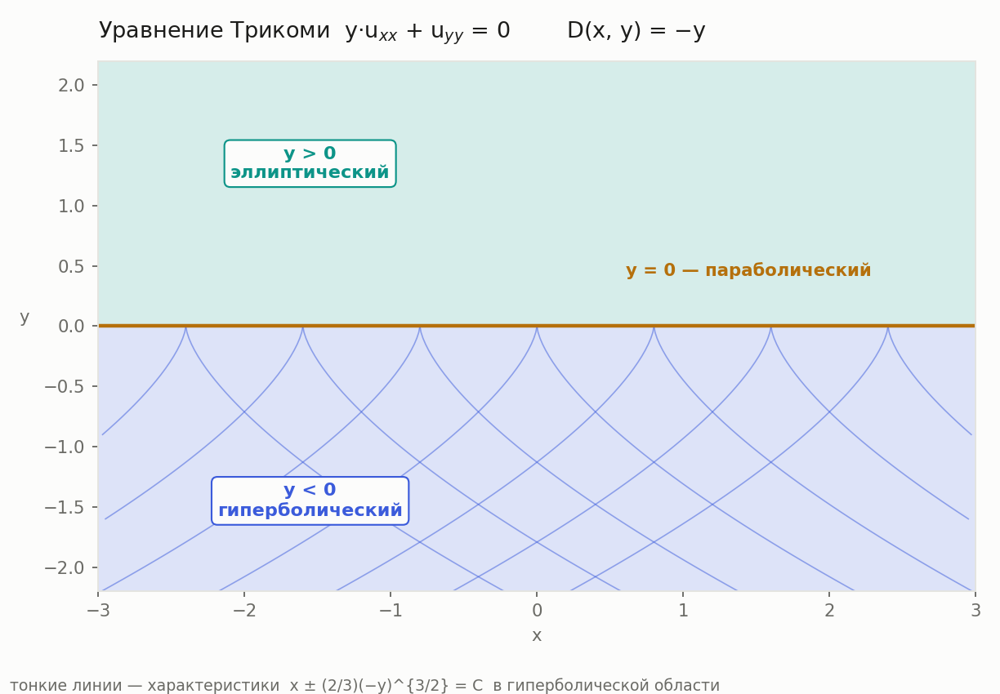
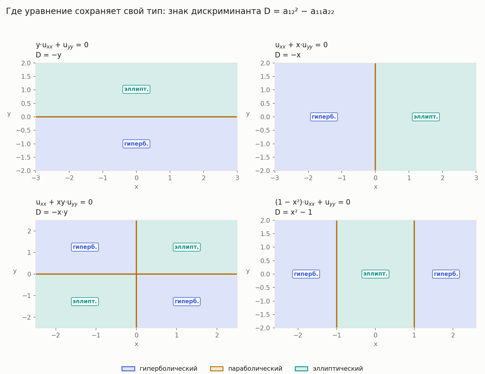

# Классификация ДУЧП 2-го порядка и приведение к каноническому виду

**Состав группы:** _(фамилии участников)_

Выполнены все три пункта — A, B и C. Язык — Python 3 (ядро) и JavaScript (виджет).
Готовые функции, решающие саму задачу, не использовались; что именно написано
руками, разобрано в конце отчёта.

---

## A. Определение типа и замены переменных по коэффициентам

Реализованы **два независимых метода** — это заодно даёт взаимную проверку.

### A.1. Произвольное число переменных — метод Лагранжа

Уравнение `Σᵢⱼ aᵢⱼ·u_xᵢxⱼ + F = 0` задаёт характеристическую квадратичную форму
`Q(λ) = Σᵢⱼ aᵢⱼ λᵢλⱼ`. Выделением полных квадратов она приводится к виду
`Σ βᵢ μᵢ²` заменой `μ = Cλ`. Далее `P = C⁻¹`, и замена переменных в самом
уравнении есть **`ξ = Pᵀx`** — уравнение принимает вид `Σ βᵢ·u_ξᵢξᵢ + F̃ = 0`.

Тип читается по набору `β`:

| условие на β | тип |
|---|---|
| все `βᵢ ≠ 0`, знаки не все одинаковы | гиперболический |
| есть `βᵢ = 0` | параболический |
| все `βᵢ ≠ 0` и одного знака | эллиптический |

Отдельно отмечаются вырожденные сигнатуры, которых нет в лекции: при `n ≥ 4`
набор `(1,1,−1,−1)` — ультрагиперболический, а `(1,−1,0)` — ультрапараболический.
Основной тип при этом выставляется по правилу лекции.

Тонкое место — форма без единого квадрата (например `Q = λ₁λ₂`): выделять нечего.
Тогда сначала делается замена `λᵢ = (νᵢ+νⱼ)/2`, `λⱼ = (νᵢ−νⱼ)/2`, и только потом
выделяются квадраты. Это ровно приём из Примера 1 разбора к лекции.

**Пример 1.** `u_xy − 2u_xz + u_yz + u_x + ½u_y = 0`

```
тип:    гиперболический,  β = (1, −1, 1)

              ⎡ 1/2   1/2  −1/2 ⎤              ⎡ 1   1  −√2/2 ⎤
        C  =  ⎢ 1/2  −1/2   3/2 ⎥       P  =   ⎢ 1  −1   √2   ⎥
              ⎣  0     0    √2  ⎦              ⎣ 0   0   √2/2 ⎦

замена: ξ₁ = x + y      ξ₂ = x − y      ξ₃ = √2·(−x + 2y + z)/2
канон:  u_ξ₁ξ₁ − u_ξ₂ξ₂ + u_ξ₃ξ₃ + F̃ = 0
проверка PᵀAP = diag(β): сходится
```

**Пример 2.** `u_xx + 2u_xy + 5u_yy − 32u = 0`

```
тип:    эллиптический,  β = (1, 1)
замена: ξ₁ = x      ξ₂ = −x/2 + y/2
канон:  u_ξ₁ξ₁ + u_ξ₂ξ₂ + F̃ = 0
```

Оба ответа совпали с разбором к лекции посимвольно, включая радикалы.

### A.2. Две переменные — метод характеристик

Для `a₁₁u_xx + 2a₁₂u_xy + a₂₂u_yy + F = 0` характеристическое уравнение
`a₁₁dy² − 2a₁₂dxdy + a₂₂dx² = 0` имеет дискриминант **`D = a₁₂² − a₁₁a₂₂`**:

* `D > 0` — две характеристики, `ξ = φ`, `η = ψ`, канон `u_ξη = Φ`;
* `D = 0` — одна характеристика, `ξ = φ`, `η` берётся любой с ненулевым якобианом, канон `u_ηη = Φ`;
* `D < 0` — корни комплексно сопряжены, `ξ = Re φ`, `η = Im φ`, канон `u_ξξ + u_ηη = Φ`.

| уравнение | D | тип | замена | новые A₁₁, A₁₂, A₂₂ |
|---|---|---|---|---|
| `u_xx − 2u_xy + u_yy + 9u_x + 9u_y − 9u = 0` | 0 | параболический | ξ = x+y, η = x | 0, 0, 1 |
| волновое `u_tt − u_xx = 0` | 1 | гиперболический | ξ = y−x, η = y+x | 0, −2, 0 |
| теплопроводности `u_t = u_xx` | 0 | параболический | ξ = y, η = x | 0, 0, 1 |
| Лапласа `u_xx + u_yy = 0` | −1 | эллиптический | ξ = y, η = x | 1, 0, 1 |

Отдельно разобран случай `a₁₁ = 0`, на котором формула `dy/dx = (a₁₂ ± √D)/a₁₁`
делится на ноль: характеристическое уравнение решается относительно `dx/dy`,
а при `a₁₁ = a₂₂ = 0` уравнение уже в первой канонической форме.

**Как программа себя проверяет.** Найденные `ξ` и `η` подставляются обратно, и
пересчитываются коэффициенты при старших производных:

```
A₁₁ = a₁₁ξ²ₓ + 2a₁₂ξₓξ_y + a₂₂ξ²_y
A₁₂ = a₁₁ξₓηₓ + a₁₂(ξₓη_y + ξ_yηₓ) + a₂₂ξ_yη_y
A₂₂ = a₁₁η²ₓ + 2a₁₂ηₓη_y + a₂₂η²_y
```

Для гиперболического типа обязаны занулиться `A₁₁` и `A₂₂`, для параболического —
`A₁₁` и `A₁₂`, для эллиптического — `A₁₂` при `A₁₁ = A₂₂`. Это не пересказ теории,
а вычисляемый признак: именно он стоит в тестах.

---

## B. Интерактивный виджет

Файл `widget/index.html` — открывается двойным щелчком, интернет и установка
не нужны. Опубликованная версия: **https://claude.ai/code/artifact/939246f8-6910-41a9-8687-2feded11c211**

Три режима:

1. **Две переменные.** Ползунки и числовые поля для `a₁₁, a₁₂, a₂₂`. При любом
   движении сразу пересчитываются `D`, тип, характеристики, замена `ξ, η`,
   якобиан, новые коэффициенты и канонический вид. Показан и ход решения —
   как получен дискриминант и корни характеристического уравнения.
2. **Переменные коэффициенты.** Коэффициенты вводятся как выражения от `x, y`
   (`y`, `x*y`, `1-x^2`, `sqrt`, `sin`, …). Строится карта областей; при
   наведении курсора показывается тип в точке, по щелчку — полный разбор в ней.
3. **n переменных.** Матрица `aᵢⱼ` до 5×5: метод Лагранжа, `β`, тип, замена
   `ξ = Pᵀx` и результат проверки `PᵀAP = diag(β)`.

В каждом режиме есть готовые примеры: волновое, теплопроводности, Лапласа,
Трикоми, все примеры из лекции.

Виджет не обращается к Python — вся арифметика продублирована на JavaScript,
причём в режиме `n` переменных она **точная**: дроби на `BigInt`, без потери
разрядов. Разбор выражений `a(x,y)` — собственный рекурсивный парсер, без `eval`.

---

## C. Уравнения с переменными коэффициентами: где какой тип

Если `a₁₁, a₁₂, a₂₂` зависят от точки, то и `D(x,y) = a₁₂² − a₁₁a₂₂` зависит от
точки. Плоскость разбивается на области постоянства знака `D`, и в каждой
уравнение приводится к своему каноническому виду.

Алгоритм: вычисляем `D` символьно → находим границы `D = 0` → берём в каждой
области пробную точку → по знаку `D` определяем тип → приводим к каноническому
виду с учётом знака.

Знак переменной приходится сообщать явно: при `y < 0` подстановка `y = −p` с
положительным `p` меняет знак дифференциала (`dy = −dp`), поэтому в
характеристическом уравнении у `a₁₂` меняется знак. Без этого радикалы вида
`√(−y)` не упрощаются.

### Уравнение Трикоми `y·u_xx + u_yy = 0`

`D = −y`, и уравнение меняет тип трижды:

| область | тип | замена | новые A₁₁, A₁₂, A₂₂ | канонический вид |
|---|---|---|---|---|
| `y < 0` | гиперболический | ξ = x + ⅔(−y)^{3/2}, η = x − ⅔(−y)^{3/2} | 0, 2y, 0 | `u_ξη = Φ` |
| `y = 0` | параболический | ξ = x, η = y | 0, 0, 1 | `u_ηη = Φ` |
| `y > 0` | эллиптический | ξ = x, η = ⅔·y^{3/2} | y, 0, y | `u_ξξ + u_ηη = Φ` |

Совпадает со слайдами 15–17 лекции.



### Другие примеры



| уравнение | D | области |
|---|---|---|
| `u_xx + x·u_yy = 0` | `−x` | `x < 0` гипер., `x = 0` парабол., `x > 0` эллипт. |
| `u_xx + xy·u_yy = 0` | `−xy` | тип меняется по квадрантам |
| `(1 − x²)·u_xx + u_yy = 0` | `x² − 1` | `x < −1` гипер., `x = −1` парабол., `−1 < x < 1` эллипт., `x = 1` парабол., `x > 1` гипер. |

Последний пример показывает, что областей может быть больше трёх: границ столько,
сколько корней у `D`.

---

## Проверка корректности

`python -m unittest discover -s tests -t .` → **96 тестов, все проходят.**

Тесты писались до кода, а эталонами служили ответы из лекции и разбора к ней:
матрицы `C` и `P` Примера 1 сверяются посимвольно вместе с `√2`, характеристики
Трикоми — с точностью до знака (φ и −φ задают одно семейство).

Помимо сверки с лекцией проверяются вычисляемые тождества, которые не зависят от
способа решения:

* `PᵀAP = diag(β)` — для каждого разобранного уравнения;
* зануление нужных `A₁₁, A₁₂, A₂₂` после подстановки найденной замены;
* ненулевой якобиан замены — иначе замена вырождена;
* **согласие двух методов**: для девяти наборов коэффициентов метод Лагранжа и
  метод характеристик обязаны дать один и тот же тип.

Отдельно покрыты случаи, на которых наивная реализация ломается: `a₁₁ = 0`,
форма без квадратов, пустая старшая часть, нулевая форма.

---

## Про запрет встроенных функций

Готовые классификаторы ДУЧП и решатели уравнений не используются. Руками написаны:

* метод Лагранжа, включая замену при отсутствии квадратов;
* обращение матрицы методом Гаусса-Жордана над точными числами (не `numpy.linalg`);
* правило классификации по сигнатуре;
* решение характеристического уравнения, включая вырождение `a₁₁ = 0`;
* интегрирование характеристик разделением переменных;
* разбиение плоскости на области и обход связных компонент для подписей;
* в виджете — точная арифметика дробей и парсер выражений.

`sympy` используется только как калькулятор точной арифметики: дроби, радикалы,
производные, первообразные, корни многочлена. `matplotlib` — только рисование.

## Как запустить

```bash
python demo.py                                  # все примеры из лекции
python plot_regions.py                          # карты областей
python -m unittest discover -s tests -t .       # тесты
```

Виджет — открыть `widget/index.html` в браузере.
